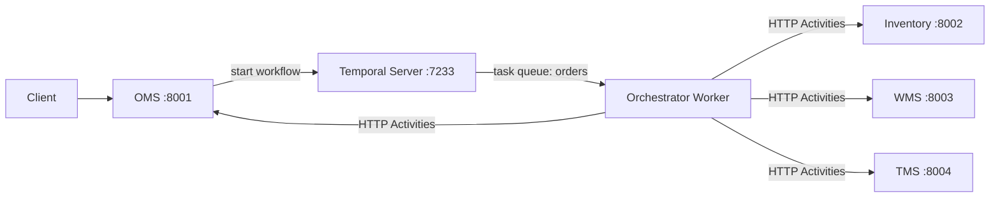

# Temporal microservices orchestration POC

A learning POC: OMS starts a real Temporal workflow; a separate worker executes HTTP activities against independent OMS, Inventory, WMS and TMS services. No application database, Redis, broker or external API is used. Mock idempotency and business state live only in each service's memory.

## Run it

From this directory run `docker compose up --build`. OMS is at `http://localhost:8001`, Inventory at `:8002`, WMS at `:8003`, TMS at `:8004`, Temporal gRPC at `:7233`, and Temporal UI at `http://localhost:8233`.

Create an order:

```sh
curl -X POST http://localhost:8001/orders -H 'content-type: application/json' -d '{"order_id":"ORD-1001","sku":"SKU-101","quantity":2}'
```

Expected immediate response: `{"order_id":"ORD-1001","workflow_id":"order-ORD-1001","status":"WORKFLOW_STARTED"}`. Repeating that ID returns HTTP 409 rather than starting a duplicate. Omit `order_id` to have OMS generate one. Query progress with `curl http://localhost:8001/orders/ORD-1001/workflow`.

## What Temporal does



The server stores workflow history and schedules tasks; it does not run Python business code. A worker polls the `orders` task queue, replays deterministic workflow code from history, and runs activity code. A workflow is the durable sequence and its queryable progress. Activities do HTTP and can be retried. Workflow code contains no network calls or nondeterministic work.

The workflow reserves inventory, fulfills at WMS, creates a TMS shipment and marks OMS complete. The default activity policy is 1 second initial delay, coefficient 2, 10 second maximum interval and 3 attempts. Each attempt has a 30 second start-to-close timeout and a 100 second schedule-to-close limit. HTTPX itself does not retry; its timeout defaults to 25 seconds. HTTP 5xx, network errors and timeouts become retryable `DownstreamError` application failures. HTTP 422 becomes non-retryable `BusinessError`.

After an exhausted forward failure, Saga compensation runs in reverse: cancel TMS if created, cancel WMS if fulfilled, release inventory if reserved, then mark the OMS order failed. Each successful forward step is registered immediately. Compensation records success or failure in the query result; a failure leaves `COMPENSATION_INCOMPLETE`, not a false rollback claim. Compensation currently shares the bounded retry policy.

Temporal provides durable workflow history, not exactly-once HTTP execution. The services accept a deterministic `operation_id`, and repeated successful requests return the prior result. A timeout can happen after a service has committed: retry uses the same operation ID, gets the stored response, and avoids a second effect. This in-memory idempotency is lost when that service restarts; production needs durable idempotency and, where needed, an operation-status reconciliation API.

The development server is configured with a mounted file for its local history. It is for this POC, not a production durability or backup design. Worker failure pauses task execution; restart the worker and Temporal replays history to continue. Temporal Server failure interrupts orchestration availability. Downstream failure makes an activity fail/retry. HTTP timeout means the response missed its deadline and the remote outcome can be ambiguous. Activity failure is not immediately workflow failure: it may retry first. Workflow failure occurs when workflow code fails or an activity's retry policy is exhausted and compensation finishes.

## Inject failures

All services expose `POST /admin/failure`, `POST /admin/reset`, and `GET /admin/state`. Configure the operation path name (`reserve`, `release`, `fulfill`, `cancel`, `shipments`, `shipments/cancel`). Modes: `none`, `http_500`, `http_503`, `fail_n_times`, `timeout`, `delay`, `business_error`, `connection_drop`. `connection_drop` is approximated as HTTP 503; reliably dropping sockets is not implemented. Service logs include operation ID, attempt and injected mode.

Transient inventory failure twice, then success:

```sh
curl -X POST localhost:8002/admin/failure -H 'content-type: application/json' -d '{"operation":"reserve","mode":"fail_n_times","fail_count":2}'
curl -X POST localhost:8001/orders -H 'content-type: application/json' -d '{"order_id":"ORD-retry","quantity":1}'
curl localhost:8002/admin/state
```

Permanent WMS failure (inventory should be released):

```sh
curl -X POST localhost:8003/admin/failure -H 'content-type: application/json' -d '{"operation":"fulfill","mode":"business_error"}'
curl -X POST localhost:8001/orders -H 'content-type: application/json' -d '{"order_id":"ORD-business","quantity":1}'
curl localhost:8002/admin/state
```

TMS unavailable after bounded attempts (WMS cancellation, then inventory release):

```sh
curl -X POST localhost:8004/admin/failure -H 'content-type: application/json' -d '{"operation":"shipments","mode":"http_503"}'
curl -X POST localhost:8001/orders -H 'content-type: application/json' -d '{"order_id":"ORD-tms","quantity":1}'
```

Timeout after the first commit; set service delay to 15 seconds, greater than the activity HTTP timeout. Retry is idempotent:

```sh
curl -X POST localhost:8002/admin/failure -H 'content-type: application/json' -d '{"operation":"reserve","mode":"timeout"}'
curl -X POST localhost:8001/orders -H 'content-type: application/json' -d '{"order_id":"ORD-timeout","quantity":1}'
```

Other modes use the same body; `delay` accepts `delay_seconds`. Reset a service with `curl -X POST localhost:8002/admin/reset`. State includes attempts and in-memory business state.

To exercise worker recovery, configure WMS `fulfill` with `delay` and `delay_seconds:20`, start an order, stop the `orchestrator` container while it is running (`docker compose stop orchestrator`), then restart it (`docker compose start orchestrator`). Find the same workflow ID in the UI and inspect its event history. Worker restart preserves Temporal history; restarting mock services clears their local state.

In the UI, open the workflow to inspect scheduled/started/completed activity events, retries, failures, workflow status and compensation activities. Use `docker compose logs -f orchestrator inventory wms tms oms` to correlate activity and service logs. Temporal is task/history orchestration; unlike Kafka, this example is not a durable event-broker/pub-sub integration.

## Local test

Python 3.11+: `pip install -r requirements.txt`, then `python -m unittest tests.test_orchestration_poc -v`. This test starts Temporal's real ephemeral test server and runs the actual workflow. For the complete HTTP/retry/compensation scenarios, run Compose and use the curl examples above. Docker was unavailable in the build environment, so Compose startup was not verified here.
